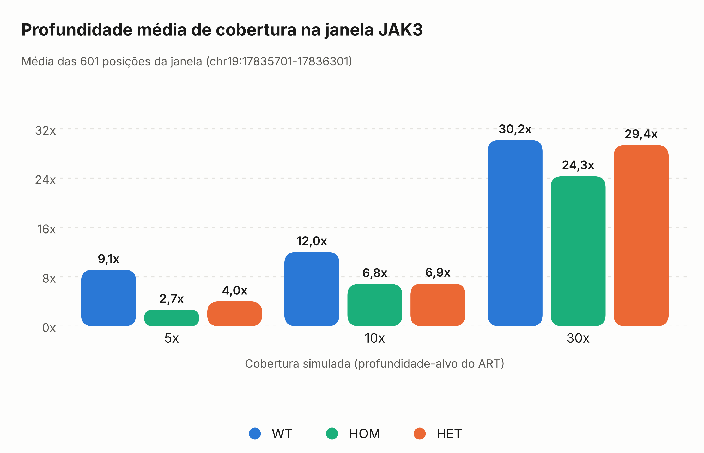
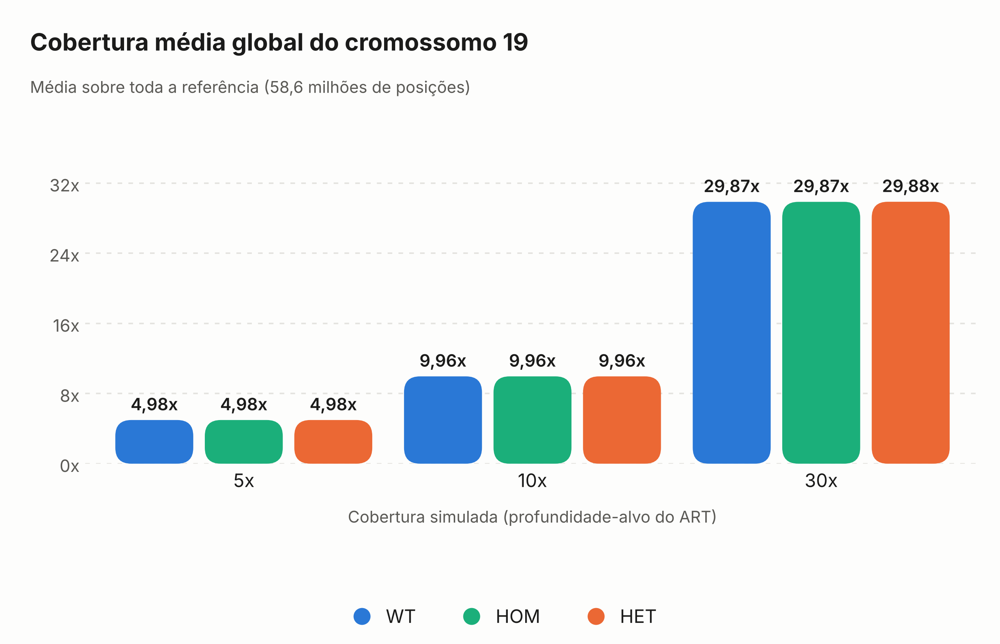
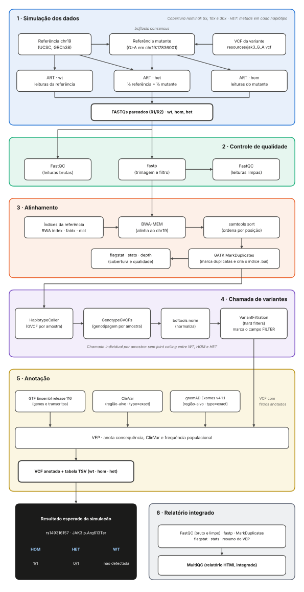

# Pipeline Snakemake para simulação, chamada e anotação de variantes germinativas na região-alvo do gene JAK3

*Estudo de caso com reads sintéticas para avaliação da detecção da variante **JAK3 c.1837C>T (p.Arg613Ter; rs149316157)**.*

<a name="indice"></a>
## 📋 Índice

1. [🎯 Apresentação e objetivo](#1-apresentacao-e-objetivo)
2. [🧬 Contexto biológico](#2-contexto-biologico-gene-jak3-variante-e-doenca)
3. [📊 Resumo dos resultados](#3-resumo-dos-resultados)
4. [🚀 Como executar](#4-como-executar)
5. [🏗️ Arquitetura do pipeline](#5-arquitetura-do-pipeline)
6. [📁 Estrutura do repositório](#6-estrutura-do-repositorio)
7. [🖥️ Requisitos](#7-requisitos)
8. [🚧 Limitações e próximas etapas](#8-limitacoes-e-proximas-etapas)
9. [📚 Referências](#9-referencias)

<a name="1-apresentacao-e-objetivo"></a>
## 🎯 1. Apresentação e objetivo

Este projeto apresenta o desenvolvimento de um pipeline de bioinformática para simulação, processamento e análise de reads de sequenciamento, utilizando o **Snakemake** para gerenciamento e automação do workflow.

O objetivo foi avaliar a recuperação de uma variante previamente definida na região-alvo do gene *JAK3*, utilizando reads sintéticas *paired-end* geradas com o ART Illumina [13, 14]. Foram simulados três genótipos — WT (0/0), HOM (1/1) e HET (0/1) — em três níveis de cobertura nominal: 5x, 10x e 30x. A região analisada compreende 601 bp do cromossomo 19 (GRCh38; `chr19:17835701-17836301`).

As reads são simuladas a partir da sequência completa do cromossomo 19; entretanto, a chamada de variantes e a avaliação da profundidade regional são restringidas à janela de 601 bp que contém a posição-alvo.

As reads foram submetidas a etapas automatizadas de controle de qualidade, alinhamento, cálculo de métricas, chamada, filtragem e anotação de variantes, utilizando as ferramentas descritas na seção de requisitos [15–22]. Os genótipos são construções computacionais definidas para o experimento e **não representam amostras biológicas ou clínicas reais**.

<a name="2-contexto-biologico-gene-jak3-variante-e-doenca"></a>
## 🧬 2. Contexto biológico: gene JAK3, variante e doença

O gene *JAK3* (*Janus Kinase 3*) codifica uma tirosina quinase não receptora da família JAK, envolvida na sinalização intracelular de citocinas pela via JAK-STAT. A proteína JAK3 associa-se à cadeia gama comum (γc), compartilhada pelos receptores de IL-2, IL-4, IL-7, IL-9, IL-15 e IL-21, contribuindo para o desenvolvimento e a manutenção de populações de linfócitos [1, 2].

A deficiência de JAK3 é uma causa de imunodeficiência combinada grave (SCID), com padrão de herança autossômico recessivo e fenótipo imunológico T−B+NK−. Nesse quadro, os linfócitos T e as células *natural killer* (NK) estão ausentes ou acentuadamente reduzidos, enquanto os linfócitos B estão presentes, mas podem apresentar comprometimento funcional [2, 4, 5].

A variante investigada é `NM_000215.4(JAK3):c.1837C>T (p.Arg613Ter)`, identificada pelo dbSNP `rs149316157`. Na referência genômica GRCh38, corresponde a `chr19:17836001 G>A`. É uma SNV do tipo *nonsense* (*stop-gain*), que introduz um códon de parada prematuro. A variante está classificada como patogênica no ClinVar, com revisão por painel de especialistas do ClinGen [6, 7, 8].

| Característica | Descrição |
|---|---|
| Gene | *JAK3* (*Janus Kinase 3*) |
| Referência genômica | GRCh38 |
| Coordenada genômica | `chr19:17836001` |
| Alteração genômica | `G>A` |
| Transcrito RefSeq | `NM_000215.4` (MANE Select) |
| Transcrito Ensembl | `ENST00000458235.7` (MANE Select; Ensembl Canonical) |
| Alteração no cDNA | `c.1837C>T` |
| Alteração proteica | `p.Arg613Ter` |
| dbSNP | `rs149316157` |
| ClinVar | `VCV000644288` — Pathogenic |
| gnomAD Exomes v4.1.1 | AF global = `6.84089 × 10⁻⁶` [10] |

Como o gene *JAK3* está localizado na fita reversa do cromossomo 19, a substituição G>A observada na referência genômica corresponde à alteração complementar C>T na sequência do transcrito.

O transcrito RefSeq `NM_000215.4` corresponde ao transcrito Ensembl `ENST00000458235.7` (JAK3-201), classificado como MANE Select e Ensembl Canonical [3, 9].

**Nota sobre o registro multialélico:** o identificador `rs149316157` também está associado à substituição `G>T` na mesma posição, correspondente a `c.1837C>A (p.Arg613=)`, uma alteração sinônima classificada como *Likely benign* em uma submissão individual ao ClinVar. Este projeto investiga especificamente o alelo `G>A` (`c.1837C>T; p.Arg613Ter`), e não o alelo `G>T` [6, 8, 11].

<a name="3-resumo-dos-resultados"></a>
## 📊 3. Resumo dos resultados

A cobertura média observada na janela de 601 bp foi comparada entre os três genótipos e os níveis de cobertura nominal. Os valores regionais não são necessariamente iguais à cobertura solicitada na simulação.



*Figura 1. Cobertura média observada na região-alvo do gene JAK3 (601 bp), calculada a partir de `samtools depth`, para cada genótipo e cobertura nominal.*



*Figura 2. Cobertura média global do cromossomo 19, para cada genótipo e cobertura nominal.*

No cromossomo 19, a cobertura média global estimada pelas estatísticas do SAMtools ficou próxima dos valores nominais solicitados nos três experimentos: 4,98x, 9,96x e aproximadamente 29,87–29,88x. Na janela de 601 bp, entretanto, HOM e HET apresentaram profundidade média inferior à de WT. Essa diferença ainda não foi investigada sistematicamente. O uso de *seeds* pseudoaleatórias distintas é uma possível fonte de variação entre as simulações, mas sua contribuição não foi isolada experimentalmente.

Os gráficos complementares, incluindo profundidade na posição da variante, desvio padrão (SD) e coeficiente de variação (CV), estão disponíveis em [`docs/figures/`](docs/figures/).

**Resumo das chamadas da variante-alvo:**

| Cobertura | Amostra | GT | DP (VCF) | AD (REF,ALT) | GQ |
|---|---|---:|---:|---:|---:|
| 5x | WT | Sem registro na posição-alvo | — | — | — |
| 5x | HOM | 1/1 | 2 | 0,2 | 6 |
| 5x | HET | 0/1 | 3 | 1,2 | 30 |
| 10x | WT | Sem registro na posição-alvo | — | — | — |
| 10x | HOM | 1/1 | 4 | 0,4 | 12 |
| 10x | HET | 0/1 | 5 | 2,3 | 66 |
| 30x | WT | Sem registro na posição-alvo | — | — | — |
| 30x | HOM | 1/1 | 17 | 0,17 | 51 |
| 30x | HET | 0/1 | 27 | 12,15 | 99 |

A ausência de registro na posição-alvo no VCF não corresponde a uma chamada explícita de genótipo 0/0 com DP e GQ informados. Por isso, esses campos não são apresentados para as amostras WT.

O DP desta tabela é a profundidade usada pelo GATK na chamada (campo `DP` do VCF) e pode diferir em algumas reads da profundidade calculada pelo `samtools depth` nos gráficos; por exemplo, no HOM 30x são 17 reads no VCF e 18 no `samtools depth`.

Os valores de GQ são apresentados como indicadores de confiança genotípica e não são utilizados como critérios de filtragem nesta versão.

Os arquivos de saída de cada experimento (TSVs anotados, `depth`, `flagstat`, `stats`, `markdup_metrics` e `config.yaml`) estão em [`experiments/independent_seeds/`](experiments/independent_seeds/), nas pastas `coverage_5x`, `coverage_10x` e `coverage_30x`.

<a name="4-como-executar"></a>
## 🚀 4. Como executar

Antes de executar, confira os requisitos de sistema, ambiente e ferramentas apresentados na [seção 7 — Requisitos](#7-requisitos).

### Quick start

**1. Clone o repositório e entre no diretório:**

```bash
git clone https://github.com/Hayato221/pipeline-snakemake-jak3.git
cd pipeline-snakemake-jak3
```

**2. Crie e ative um ambiente com Snakemake:**

```bash
conda create -n snakemake-jak3 -c conda-forge -c bioconda snakemake=9.25.1
conda activate snakemake-jak3
```

**3. Revise a configuração em `config/config.yaml`.** O arquivo versionado está configurado para cobertura nominal de 30x (`wt: 30`, `hom: 30` e `het: 15`; no HET, são simuladas 15x para cada alelo).

**4. Verifique as regras e visualize o planejamento:**

```bash
snakemake --list-rules
snakemake --dry-run --cores 1 --sdm conda
```

**5. Execute o pipeline:**

```bash
snakemake --cores 1 --sdm conda
```

### Utilizar outra configuração de cobertura

Para verificar o planejamento do experimento 5x sem executar as tarefas:

```bash
snakemake --dry-run --cores 1 --sdm conda \
  --configfile experiments/independent_seeds/coverage_5x/config.yaml
```

Para executar o experimento 5x:

```bash
snakemake --cores 1 --sdm conda \
  --configfile experiments/independent_seeds/coverage_5x/config.yaml
```

Troque `coverage_5x` por `coverage_10x` ou `coverage_30x` conforme o experimento.

> **Importante:** as configurações de 5x, 10x e 30x alteram os parâmetros de simulação, mas as regras desta versão gravam os resultados nos mesmos diretórios de saída (`results/`). Antes de executar outro nível de cobertura, preserve os resultados da execução anterior. As pastas em `experiments/independent_seeds/` contêm cópias selecionadas dos resultados já obtidos e não são os diretórios de saída automática do workflow.

Na primeira execução, o Snakemake cria automaticamente os ambientes Conda definidos nos arquivos de `envs/`. O workflow também baixa a referência FASTA do cromossomo 19 da UCSC, o GTF do Ensembl 116 e extrai as regiões correspondentes dos bancos ClinVar e gnomAD indicados no `config/config.yaml` [10, 24–26]. Esses arquivos são armazenados em `reference/`, diretório gerado localmente e não versionado no Git.

<a name="5-arquitetura-do-pipeline"></a>
## 🏗️ 5. Arquitetura do pipeline

O workflow está dividido em módulos Snakemake [23] que organizam as etapas de preparação das referências, simulação, controle de qualidade, alinhamento, métricas, chamada de variantes, anotação e geração de relatórios.



*Fluxograma do workflow, da simulação das reads ao VCF anotado e ao relatório integrado.*

A anotação funcional é realizada com o Ensembl Variant Effect Predictor (VEP) 116.2 [21], utilizando o GTF local do Ensembl release 116 e o FASTA local da referência GRCh38. O comando não utiliza o cache de anotação do VEP. As informações adicionais de ClinVar (versão arquivada de 11/10/2026) e gnomAD Exomes v4.1.1 são incorporadas por meio de arquivos VCF regionais locais, utilizando a opção `type=exact` para garantir a correspondência das anotações com o alelo específico [10, 12, 26].

<a name="6-estrutura-do-repositorio"></a>
## 📁 6. Estrutura do repositório

```text
pipeline-snakemake-jak3/
├── Snakefile
├── config/
│   └── config.yaml
├── rules/
│   ├── reference.smk
│   ├── simulation.smk
│   ├── quality.smk
│   ├── alignment.smk
│   ├── metrics.smk
│   ├── variant_caller.smk
│   ├── annotation.smk
│   └── reports.smk
├── envs/
├── resources/
│   ├── jak3_G_A.vcf
│   └── clinvar_chr_rename.txt
├── experiments/
│   └── independent_seeds/
│       ├── coverage_5x/
│       ├── coverage_10x/
│       └── coverage_30x/
├── docs/
│   └── figures/
├── data/          # reads simuladas (gerado durante a execução)
├── intermediate/  # arquivos intermediários (gerado durante a execução)
├── reference/     # referências e bancos locais (gerado durante a execução)
├── results/       # saídas intermediárias e finais (gerado durante a execução)
└── logs/          # registros da execução
```

O diretório `results/` é criado durante a execução e armazena os arquivos intermediários e finais produzidos pelo workflow. Arquivos declarados como temporários (`temp()`) são removidos automaticamente pelo Snakemake quando deixam de ser necessários para as etapas posteriores.

Os diretórios `data/`, `intermediate/`, `reference/`, `results/` e os logs de execução são excluídos do versionamento pelo `.gitignore`. Os resultados selecionados de cada experimento ficam em `experiments/independent_seeds/`: cada pasta `coverage_Nx/` contém o `config.yaml` correspondente e, para cada amostra, o TSV anotado, `depth`, `flagstat`, `stats` e `markdup_metrics`. As figuras utilizadas na documentação ficam em `docs/figures/`.

<a name="7-requisitos"></a>
## 🖥️ 7. Requisitos

### Sistema operacional e ambiente

- Linux (Ubuntu recomendado) ou Windows utilizando WSL2 com Ubuntu.
- Conda ou Mamba instalado e inicializado no terminal.
- Snakemake 9.25.1, instalado no ambiente utilizado para executar o workflow [23].
- Conexão com a internet na primeira execução para criação dos ambientes Conda e obtenção das referências e bancos de anotação.

### Ferramentas de bioinformática

As ferramentas são instaladas automaticamente em ambientes Conda separados, definidos nos arquivos de `envs/`.

| Ferramenta | Versão | Finalidade |
|---|---:|---|
| ART Illumina [13, 14] | 2016.06.05 | Simulação de reads paired-end |
| FastQC [15] | 0.13.0 | Controle de qualidade |
| fastp [16] | 1.4.0 | Processamento e filtragem das reads |
| BWA-MEM [17] | 0.7.19 | Alinhamento à referência |
| SAMtools [18] | 1.24 | Processamento de BAM e cálculo de métricas |
| GATK4 [19, 20] | 4.7.0.0 | Marcação de duplicatas e chamada de variantes |
| BCFtools [18] | 1.24 | Manipulação e normalização de VCF |
| HTSlib [18] | 1.24 | Compressão e indexação de arquivos genômicos |
| Ensembl VEP [21] | 116.2 | Anotação funcional das variantes |
| MultiQC [22] | 1.35 | Consolidação de relatórios e métricas |

### Referências genômicas e bancos de dados

- Genoma de referência: GRCh38 — cromossomo 19, obtido da UCSC [24].
- Anotação gênica: Ensembl release 116 [25].
- ClinVar: versão arquivada de 11/10/2026 [26].
- gnomAD Exomes: versão 4.1.1 [10].

O consumo de memória e a necessidade de espaço em disco variam conforme a cobertura configurada e a quantidade de arquivos intermediários gerados. Em computadores com recursos limitados, recomenda-se iniciar a execução com `--cores 1` e reservar espaço suficiente para os arquivos FASTQ, BAM, VCF e demais saídas do workflow.

<a name="8-limitacoes-e-proximas-etapas"></a>
## 🚧 8. Limitações e próximas etapas

- Os dados utilizados são sintéticos e representam genótipos previamente definidos; os resultados não devem ser interpretados como validação clínica ou desempenho diagnóstico.
- A análise está restrita a uma janela de 601 bp do gene *JAK3* e a uma variante SNV previamente selecionada.
- Os *hard filters* configurados no GATK VariantFiltration foram definidos para SNPs e não devem ser considerados validados para indels.
- A genotipagem é realizada individualmente por amostra; o workflow não implementa *joint calling* entre WT, HOM e HET.
- Na janela de 601 bp, a profundidade média do HOM e do HET ficou abaixo da do WT, enquanto a cobertura global do cromossomo 19 foi equivalente entre os genótipos; a causa não foi investigada sistematicamente.
- As métricas globais de `samtools stats` e a profundidade regional de `samtools depth` utilizam critérios de inclusão e exclusão diferentes. O comando `samtools stats` é executado sem a opção `-d`, mantendo as reads marcadas como duplicatas nas estatísticas. Já o `samtools depth`, em sua configuração padrão, exclui reads duplicadas, secundárias e reprovadas no controle de qualidade (QCFAIL), além das não mapeadas. Essa diferença deve ser considerada na comparação das métricas de cobertura.

**Próximas etapas:**

- Implementar o gerenciamento de memória por regra (`mem_mb`), definindo estimativas de memória (em MB) para as diferentes etapas do pipeline.
- Repetir a simulação com a mesma *seed* para WT, HOM e HET, para verificar se a diferença de profundidade observada na janela de 601 bp decorre da variação aleatória entre as simulações.
- Repetir as simulações com múltiplas *seeds* e mais níveis de cobertura, para estimar a cobertura mínima em que a variante é recuperada de forma consistente.
- Simular também o alelo `G>T` (*p.Arg613=*), do mesmo identificador `rs149316157`, para verificar se o pipeline diferencia os dois alelos.
- Comparar a genotipagem individual com o *joint calling* entre WT, HOM e HET, avaliando o efeito sobre as chamadas, inclusive o registro explícito do genótipo 0/0 do WT na posição-alvo.
- Padronizar os critérios de inclusão e exclusão de reads no cálculo da cobertura regional e global, para que as métricas sejam diretamente comparáveis.
- Gerar a tabela-resumo das chamadas com `pandas`, lendo automaticamente os TSVs anotados e as métricas de cobertura, em vez de transcrever os valores manualmente.
- Validar automaticamente o arquivo de configuração antes da execução (campos obrigatórios, tipos e intervalos de valores).
- Verificar previamente os arquivos de entrada (existência, conteúdo e concordância do alelo de referência do VCF com o FASTA).
- Criar testes automatizados para as etapas principais do workflow.

<a name="9-referencias"></a>
## 📚 9. Referências

[1] YAMAOKA, K. et al. The Janus kinases (Jaks). *Genome Biology*, v. 5, n. 12, art. 253, 2004. https://doi.org/10.1186/gb-2004-5-12-253.

[2] LIONGUE, C. et al. Janus Kinase 3 (JAK3): A Critical Conserved Node in Immunity Disrupted in Immune Cell Cancer and Immunodeficiency. *International Journal of Molecular Sciences*, v. 25, n. 5, art. 2977, 2024. https://doi.org/10.3390/ijms25052977.

[3] NATIONAL CENTER FOR BIOTECHNOLOGY INFORMATION (NCBI). *JAK3: Janus kinase 3 [Homo sapiens]*. Gene ID: 3718. https://www.ncbi.nlm.nih.gov/gene/3718. Acesso em: 14 nov. 2026.

[4] KUMRAH, R. et al. Genetics of severe combined immunodeficiency. *Genes & Diseases*, v. 7, n. 1, p. 52–61, 2020. https://pmc.ncbi.nlm.nih.gov/articles/PMC7063414/. Acesso em: 14 nov. 2026.

[5] PAN, Y. et al. Case Report: Mutations in JAK3 causing severe combined immunodeficiency complicated by disseminated Bacille Calmette–Guérin disease and Pneumocystis pneumonia. *Frontiers in Immunology*, v. 13, art. 1055607, 2022. https://doi.org/10.3389/fimmu.2022.1055607.

[6] NATIONAL CENTER FOR BIOTECHNOLOGY INFORMATION (NCBI). *ClinVar: JAK3 c.1837C>T (p.Arg613Ter)*. Variation ID: 644288. https://www.ncbi.nlm.nih.gov/clinvar/variation/644288/. Acesso em: 14 nov. 2026.

[7] CLINICAL GENOME RESOURCE (ClinGen). *Evidence Repository: NM_000215.4(JAK3):c.1837C>T (p.Arg613Ter)*. Classificação aprovada em 17 jan. 2024. https://erepo.clinicalgenome.org/evrepo/ui/classification/6c260c2f-fbe4-45ba-8d5b-2c8e8d058744. Acesso em: 14 nov. 2026.

[8] NATIONAL CENTER FOR BIOTECHNOLOGY INFORMATION (NCBI). *dbSNP: rs149316157 — Reference SNP Report*. https://www.ncbi.nlm.nih.gov/snp/rs149316157. Acesso em: 14 nov. 2026.

[9] ENSEMBL. *JAK3 — Transcript ENST00000458235.7, Ensembl Release 116*. https://useast.ensembl.org/Homo_sapiens/Transcript/Summary?db=core%3Bg%3DENSG00000105639%3Br%3D19%3A17824780-17848071%3Bt%3DENST00000458235. Acesso em: 14 nov. 2026.

[10] GNOMAD CONSORTIUM. *gnomAD v4.1.1 — Exomes*. Anúncio da versão: [gnomAD v4.1.1](https://gnomad.broadinstitute.org/news/2026-03-gnomad-v4-1-1/). Página de downloads: [gnomAD Downloads](https://gnomad.broadinstitute.org/downloads). Arquivo utilizado no pipeline: `gnomad.exomes.v4.1.1.sites.chr19.vcf.bgz`. Acesso em: 15 nov. 2026.

[11] NATIONAL CENTER FOR BIOTECHNOLOGY INFORMATION (NCBI). *ClinVar: NM_000215.4(JAK3):c.1837C>A (p.Arg613=)*. Variation ID: 2720908. https://www.ncbi.nlm.nih.gov/clinvar/variation/2720908/. Acesso em: 14 nov. 2026.

[12] ENSEMBL. *Variant Effect Predictor: Custom annotations*. https://www.ensembl.org/info/docs/tools/vep/script/vep_custom.html. Acesso em: 14 nov. 2026.

### Ferramentas e workflow

[13] HUANG, W. et al. ART: a next-generation sequencing read simulator. *Bioinformatics*, v. 28, n. 4, p. 593–594, 2012. DOI: [10.1093/bioinformatics/btr708](https://doi.org/10.1093/bioinformatics/btr708). Acesso em: 15 nov. 2026.

[14] UBUNTU MANPAGES. *art_illumina — Simulation of Illumina sequencers*. Ubuntu 24.04 LTS (Noble). Manual do pacote `art-nextgen-simulation-tools` (release upstream 2016-06-05; versão do pacote Ubuntu `20160605+dfsg-5`), com sintaxe, opções e exemplos de simulação paired-end, incluindo os parâmetros `-p`, `-l`, `-f`, `-m`, `-s` e `-rs`. [Ubuntu Manpage — art_illumina](https://manpages.ubuntu.com/manpages/noble/man1/art_illumina.1.html). Acesso em: 15 nov. 2026.

[15] ANDREWS, S. *FastQC: a quality control tool for high throughput sequence data*. Babraham Bioinformatics. [FastQC v0.13.0 — release notes e página do projeto](https://github.com/s-andrews/FastQC/releases/tag/v0.13.0). Acesso em: 15 nov. 2026.

[16] CHEN, S. et al. fastp: an ultra-fast all-in-one FASTQ preprocessor. *Bioinformatics*, v. 34, n. 17, p. i884–i890, 2018. DOI: [10.1093/bioinformatics/bty560](https://doi.org/10.1093/bioinformatics/bty560). Versão utilizada: [fastp v1.4.0 — release oficial](https://github.com/OpenGene/fastp/releases/tag/v1.4.0). Acesso em: 15 nov. 2026.

[17] LI, H. Aligning sequence reads, clone sequences and assembly contigs with BWA-MEM. *arXiv*, arXiv:1303.3997, 2013. Disponível em: [https://arxiv.org/abs/1303.3997](https://arxiv.org/abs/1303.3997). Versão utilizada: [BWA 0.7.19 — histórico de releases](https://github.com/lh3/bwa/releases). Acesso em: 15 nov. 2026.

[18] DANECEK, P. et al. Twelve years of SAMtools and BCFtools. *GigaScience*, v. 10, n. 2, art. giab008, 2021. DOI: [10.1093/gigascience/giab008](https://doi.org/10.1093/gigascience/giab008). Documentação versionada do SAMtools, BCFtools e utilitários HTSlib 1.24: [HTSlib 1.24 documentation](https://www.htslib.org/doc/1.24/). Acesso em: 15 nov. 2026.

[19] MCKENNA, A. et al. The Genome Analysis Toolkit: a MapReduce framework for analyzing next-generation DNA sequencing data. *Genome Research*, v. 20, n. 9, p. 1297–1303, 2010. DOI: [10.1101/gr.107524.110](https://doi.org/10.1101/gr.107524.110).

[20] DEPRISTO, M. A. et al. A framework for variation discovery and genotyping using next-generation DNA sequencing data. *Nature Genetics*, v. 43, n. 5, p. 491–498, 2011. DOI: [10.1038/ng.806](https://doi.org/10.1038/ng.806). Versão utilizada: [GATK 4.7.0.0 — release oficial](https://github.com/broadinstitute/gatk/releases/tag/4.7.0.0). Acesso em: 15 nov. 2026.

[21] MCLAREN, W. et al. The Ensembl Variant Effect Predictor. *Genome Biology*, v. 17, art. 122, 2016. DOI: [10.1186/s13059-016-0974-4](https://doi.org/10.1186/s13059-016-0974-4). Versão utilizada: [Ensembl VEP release 116.2](https://github.com/Ensembl/ensembl-vep/releases/tag/release/116.2). Acesso em: 15 nov. 2026.

[22] EWELS, P. et al. MultiQC: summarize analysis results for multiple tools and samples in a single report. *Bioinformatics*, v. 32, n. 19, p. 3047–3048, 2016. DOI: [10.1093/bioinformatics/btw354](https://doi.org/10.1093/bioinformatics/btw354). Versão utilizada: [MultiQC v1.35 — release oficial](https://github.com/MultiQC/MultiQC/releases/tag/v1.35). Acesso em: 15 nov. 2026.

[23] SNAKEMAKE. *Snakemake v9.25.1*. Release oficial da versão utilizada no projeto. [Snakemake v9.25.1 — GitHub Releases](https://github.com/snakemake/snakemake/releases/tag/v9.25.1). Acesso em: 15 nov. 2026.

### Referências genômicas e bancos de dados

[24] UCSC GENOME BROWSER. *GRCh38/hg38 — chromosome sequence downloads*. Diretório de arquivos FASTA por cromossomo: [UCSC hg38 chromosomes](https://hgdownload.soe.ucsc.edu/goldenPath/hg38/chromosomes/). Arquivo utilizado: `chr19.fa.gz`. Acesso em: 15 nov. 2026.

[25] ENSEMBL. *Homo sapiens — GRCh38, GTF annotation, release 116*. Diretório de arquivos GTF: [Ensembl release 116 — Homo sapiens GTF](https://ftp.ensembl.org/pub/release-116/gtf/homo_sapiens/). Arquivo utilizado: `Homo_sapiens.GRCh38.116.chr.gtf.gz`. Acesso em: 15 nov. 2026.

[26] NATIONAL CENTER FOR BIOTECHNOLOGY INFORMATION (NCBI). *ClinVar — Downloads*. [Página de downloads do ClinVar](https://www.ncbi.nlm.nih.gov/clinvar/docs/downloads/). Diretório de arquivos VCF GRCh38 arquivados em 2026: [ClinVar GRCh38 archive — 2026](https://ftp.ncbi.nlm.nih.gov/pub/clinvar/vcf_GRCh38/archive_2.0/2026/). Versão utilizada: `clinvar_20261011.vcf.gz`. Acesso em: 15 nov. 2026.