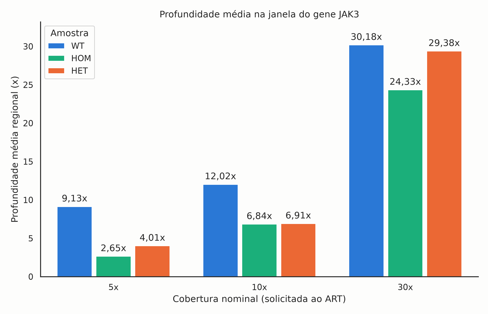
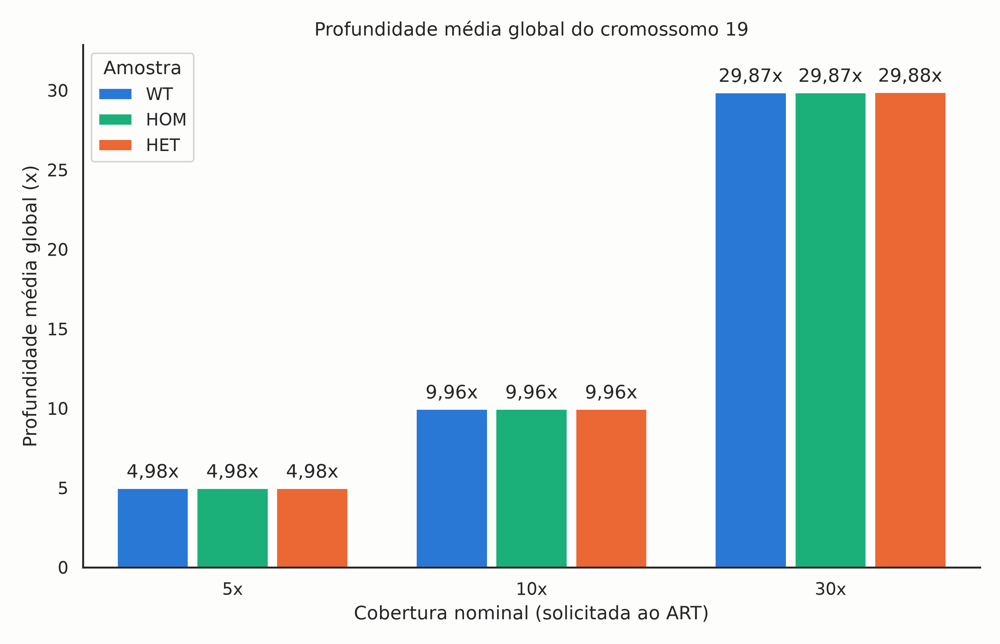
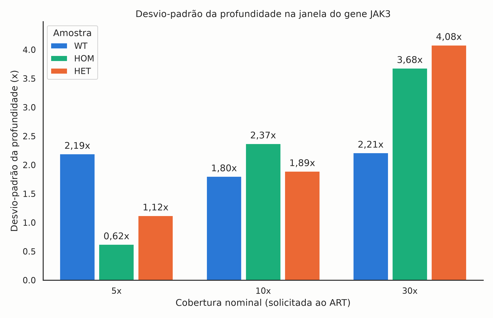
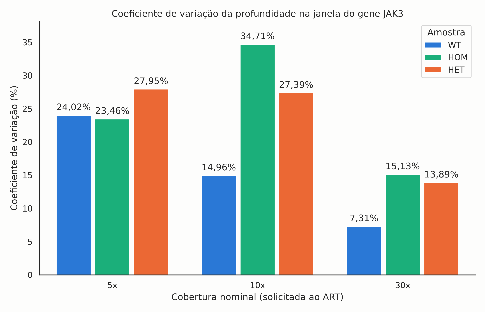
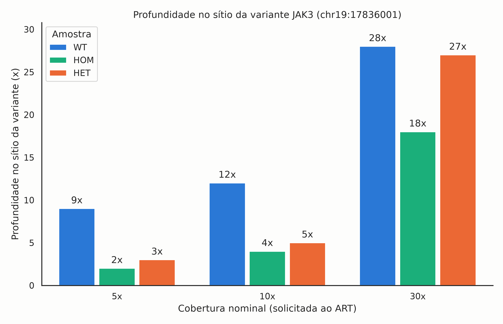

# Pipeline Snakemake para simulação, chamada e anotação de variantes germinativas na região-alvo do gene JAK3

*Estudo de caso com reads sintéticas para avaliação da detecção da variante **JAK3 c.1837C>T (p.Arg613Ter, rs149316157)**.*

<a name="indice"></a>
## 📋 Índice

1. [🎯 Apresentação e objetivo](#1-apresentacao-e-objetivo)
2. [🧬 Contexto biológico](#2-contexto-biologico-gene-jak3-variante-e-doenca)
3. [📊 Resumo dos resultados](#3-resumo-dos-resultados)
4. [🚀 Como executar](#4-como-executar)
5. [🏗️ Arquitetura do pipeline](#5-arquitetura-do-pipeline)
6. [📁 Estrutura do repositório](#6-estrutura-do-repositorio)
7. [🖥️ Requisitos](#7-requisitos)
8. [🚧 Limitações e próximas etapas](#8-limitacoes-e-proximas-etapas)
9. [📚 Referências](#9-referencias)

<a name="1-apresentacao-e-objetivo"></a>
## 🎯 1. Apresentação e objetivo

Este projeto apresenta um pipeline de bioinformática desenvolvido em **Snakemake** para automatizar etapas de simulação, processamento e análise de dados de sequenciamento.

O objetivo foi testar se o workflow conseguia recuperar a variante `JAK3 c.1837C>T (p.Arg613Ter)`, previamente introduzida nas referências utilizadas para gerar dados de sequenciamento sintéticos. Para isso, foram simuladas reads *paired-end* com o ART Illumina [13, 14], a partir de referências representando três genótipos: WT (0/0), HOM (1/1) e HET (0/1), em três níveis de cobertura nominal: 5x, 10x e 30x. A região-alvo compreende 601 bp do cromossomo 19 (GRCh38, `chr19:17835701-17836301`).

A simulação utiliza como base a sequência completa do cromossomo 19. Entretanto, a chamada de variantes e a avaliação da profundidade regional são restritas à janela de 601 bp que contém a posição-alvo.

Após a simulação, os dados passam por etapas automatizadas de controle de qualidade, alinhamento, cálculo de métricas, chamada, filtragem e anotação de variantes, utilizando as ferramentas descritas na seção de requisitos [15–22]. Os genótipos foram definidos computacionalmente e **não representam amostras biológicas ou clínicas reais**.

<a name="2-contexto-biologico-gene-jak3-variante-e-doenca"></a>
## 🧬 2. Contexto biológico: gene JAK3, variante e doença

O gene *JAK3* (*Janus Kinase 3*) codifica uma tirosina quinase não receptora da família JAK, envolvida na sinalização intracelular de citocinas pela via JAK-STAT. A proteína JAK3 associa-se à cadeia gama comum (γc), compartilhada pelos receptores de IL-2, IL-4, IL-7, IL-9, IL-15 e IL-21, contribuindo para o desenvolvimento e a manutenção de populações de linfócitos [1, 2].

A deficiência de JAK3 é uma causa de imunodeficiência combinada grave (SCID), com padrão de herança autossômico recessivo e fenótipo imunológico T−B+NK−. Nesse quadro, os linfócitos T e as células *natural killer* (NK) estão ausentes ou muito reduzidos, enquanto os linfócitos B estão presentes, mas podem apresentar comprometimento funcional [2, 4, 5].

A variante investigada é `NM_000215.4(JAK3):c.1837C>T (p.Arg613Ter)`, identificada pelo dbSNP `rs149316157`. Na referência genômica GRCh38, corresponde a `chr19:17836001 G>A`. É uma SNV do tipo *nonsense* (*stop-gain*), que introduz um códon de parada prematuro. A variante está classificada como patogênica no ClinVar, com revisão por painel de especialistas do ClinGen [6, 7, 8].

| Característica | Descrição |
|---|---|
| Gene | *JAK3* (*Janus Kinase 3*) |
| Referência genômica | GRCh38 |
| Coordenada genômica | `chr19:17836001` |
| Alteração genômica | `G>A` |
| Transcrito RefSeq | `NM_000215.4` (MANE Select) |
| Transcrito Ensembl | `ENST00000458235.7` (MANE Select e Ensembl Canonical) |
| Alteração no cDNA | `c.1837C>T` |
| Alteração proteica | `p.Arg613Ter` |
| dbSNP | `rs149316157` |
| ClinVar | `VCV000644288` — Pathogenic |
| gnomAD Exomes v4.1.1 | AF global = `6.84089 × 10⁻⁶` [10] |

Como o gene *JAK3* está localizado na fita reversa do cromossomo 19, a substituição G>A observada na referência genômica corresponde à alteração complementar C>T na sequência do transcrito.

O transcrito RefSeq `NM_000215.4` corresponde ao transcrito Ensembl `ENST00000458235.7` (JAK3-201), classificado como MANE Select e Ensembl Canonical [3, 9].

**Nota sobre o registro multialélico:** o identificador `rs149316157` também está associado à substituição `G>T` na mesma posição, correspondente a `c.1837C>A (p.Arg613=)`, uma alteração sinônima classificada como *Likely benign* em uma submissão individual ao ClinVar. Este projeto investiga especificamente o alelo `G>A` (`c.1837C>T, p.Arg613Ter`), e não o alelo `G>T` [6, 8, 11].

<a name="3-resumo-dos-resultados"></a>
## 📊 3. Resumo dos resultados

O principal resultado deste estudo de caso foi a execução do workflow de ponta a ponta e a recuperação da variante-alvo `JAK3 c.1837C>T (p.Arg613Ter)` nas amostras sintéticas HOM e HET. O pipeline realizou as etapas de simulação, controle de qualidade, alinhamento, chamada, filtragem e anotação das variantes. As chamadas observadas para HOM e HET são compatíveis com os genótipos definidos para essas simulações, demonstrando que o workflow foi capaz de identificar a variante previamente introduzida nos dados sintéticos.

**Resumo das chamadas da variante-alvo:**

| Cobertura nominal | Amostra | GT | DP (VCF) | AD (REF,ALT) | GQ | FILTER |
|---|---|---:|---:|---:|---:|---|
| 5x | WT | Sem registro na posição-alvo | — | — | — | — |
| 5x | HOM | 1/1 | 2 | 0,2 | 6 | PASS |
| 5x | HET | 0/1 | 3 | 1,2 | 30 | PASS |
| 10x | WT | Sem registro na posição-alvo | — | — | — | — |
| 10x | HOM | 1/1 | 4 | 0,4 | 12 | PASS |
| 10x | HET | 0/1 | 5 | 2,3 | 66 | PASS |
| 30x | WT | Sem registro na posição-alvo | — | — | — | — |
| 30x | HOM | 1/1 | 17 | 0,17 | 51 | PASS |
| 30x | HET | 0/1 | 27 | 12,15 | 99 | PASS |

Nas três coberturas, as amostras HOM e HET apresentaram chamadas da variante com os genótipos esperados (1/1 e 0/1, respectivamente). Todas as chamadas identificadas nessas amostras apresentaram `PASS` no campo `FILTER`, indicando que atenderam aos critérios de qualidade definidos na etapa de filtragem com GATK VariantFiltration.

Para a amostra WT, não houve registro na posição-alvo no VCF. Por isso, a tabela não apresenta uma chamada 0/0 nem valores de DP, AD, GQ e FILTER para essa amostra. Isso é esperado na chamada individual quando não há uma variante registrada nessa posição. Mesmo assim, a ausência do registro, sozinha, não comprova que o pipeline não gera falsos positivos.

O DP desta tabela é a profundidade utilizada pelo GATK na chamada (campo `DP` do VCF) e pode diferir em algumas reads da profundidade calculada pelo `samtools depth` nos gráficos. Por exemplo, no HOM 30x são 17 reads no VCF e 18 no `samtools depth`. Os valores de GQ são apresentados como indicadores de confiança genotípica e não são utilizados como critérios de filtragem nesta versão.

Os valores de GQ mostram diferenças importantes na confiança das chamadas. Na amostra HOM de 5x, o GQ foi 6, um valor muito baixo que corresponde, na escala Phred, a uma probabilidade estimada de erro de aproximadamente 25%. Portanto, essa chamada não deve ser considerada confiável. Na cobertura de 10x, o GQ 12 também indica confiança limitada, enquanto em 30x o GQ 51 representa evidência muito mais forte para o genótipo identificado. Isso demonstra que a recuperação da variante e a aprovação pelos filtros não garantem, por si só, uma chamada genotípica confiável em todas as coberturas.

Na etapa de filtragem com GATK VariantFiltration, são utilizados cinco critérios de qualidade: QUAL < 30, QD < 2, SOR > 3, FS > 60 e MQ < 40. Cada critério possui um identificador próprio, registrado no campo `FILTER` do VCF. As variantes que não atendem aos limiares são marcadas com os respectivos filtros, mas permanecem no arquivo de saída. Nesta análise, todas as chamadas HOM e HET identificadas nas três coberturas apresentaram `PASS`. As métricas MQRankSum e ReadPosRankSum não são utilizadas nesta versão. Os limiares configurados foram definidos para SNPs e não devem ser considerados filtros validados para indels.

**Análise complementar da profundidade de sequenciamento**

Além de verificar a recuperação da variante, foram comparadas as métricas de profundidade global e regional entre os três genótipos e os níveis de cobertura nominal de 5x, 10x e 30x.



*Figura 1. Profundidade média regional nas 601 posições da janela-alvo do gene JAK3, calculada a partir dos arquivos de profundidade gerados pelo `samtools depth`.*



*Figura 2. Profundidade média global estimada a partir da distribuição COV do `samtools stats`, considerando o comprimento total do cromossomo 19.*



*Figura 3. Desvio-padrão populacional das profundidades nas 601 posições da janela-alvo do gene JAK3, para cada genótipo e cobertura nominal.*



*Figura 4. Coeficiente de variação da profundidade nas 601 posições da janela-alvo, expressando a dispersão relativa em relação à profundidade média regional.*



*Figura 5. Profundidade no sítio da variante JAK3 (`chr19:17836001`), extraída dos arquivos de profundidade para cada genótipo e cobertura nominal.*

No cromossomo 19, a profundidade média global estimada pelas estatísticas do SAMtools ficou próxima dos valores nominais solicitados nos três experimentos: 4,98x, 9,96x e aproximadamente 29,87–29,88x. Na janela de 601 bp, HOM e HET apresentaram profundidade média regional inferior à de WT. Essa diferença ainda não foi investigada sistematicamente. O uso de *seeds* pseudoaleatórias distintas é uma possível fonte de variação entre as simulações, mas sua contribuição não foi isolada experimentalmente.

O desvio-padrão (DP) descreve a dispersão absoluta das profundidades entre as posições da janela, enquanto o coeficiente de variação (CV) expressa essa dispersão em porcentagem em relação à média. Essas métricas descrevem a distribuição de profundidade nas posições analisadas, e não representam intervalos de confiança nem variação entre réplicas biológicas independentes.

Os arquivos de saída de cada experimento (TSVs anotados, `depth`, `flagstat`, `stats`, `markdup_metrics` e `config.yaml`) estão em [`experiments/independent_seeds/`](experiments/independent_seeds/), nas pastas `coverage_5x`, `coverage_10x` e `coverage_30x`.

<a name="4-como-executar"></a>
## 🚀 4. Como executar

Antes de executar, confira os requisitos de sistema, ambiente e ferramentas apresentados na [seção 7 — Requisitos](#7-requisitos).

### Quick start

**1. Clone o repositório e entre no diretório:**

```bash
git clone https://github.com/Hayato221/pipeline-snakemake-jak3.git
cd pipeline-snakemake-jak3
```

**2. Crie e ative um ambiente com Snakemake:**

```bash
conda create -n snakemake-jak3 -c conda-forge -c bioconda snakemake=9.25.1
conda activate snakemake-jak3
```

**3. Revise a configuração em `config/config.yaml`.** O arquivo versionado está configurado para cobertura nominal de 30x (`wt: 30`, `hom: 30` e `het: 15`, e no HET são simuladas 15x para cada alelo).

**4. Verifique as regras e visualize o planejamento:**

```bash
snakemake --list-rules
snakemake --dry-run --cores 1 --sdm conda
```

**5. Execute o pipeline:**

```bash
snakemake --cores 1 --sdm conda
```

### Utilizar outra configuração de cobertura

Para verificar o planejamento do experimento 5x sem executar as tarefas:

```bash
snakemake --dry-run --cores 1 --sdm conda \
  --configfile experiments/independent_seeds/coverage_5x/config.yaml
```

Para executar o experimento 5x:

```bash
snakemake --cores 1 --sdm conda \
  --configfile experiments/independent_seeds/coverage_5x/config.yaml
```

Troque `coverage_5x` por `coverage_10x` ou `coverage_30x` conforme o experimento.

> **Importante:** as configurações de 5x, 10x e 30x alteram os parâmetros de simulação, mas as regras desta versão gravam os resultados nos mesmos diretórios de saída (`results/`). Antes de executar outro nível de cobertura, preserve os resultados da execução anterior. As pastas em `experiments/independent_seeds/` contêm cópias selecionadas dos resultados já obtidos e não são os diretórios de saída automática do workflow.

Na primeira execução, o Snakemake cria automaticamente os ambientes Conda definidos nos arquivos de `envs/`. O workflow também baixa a referência FASTA do cromossomo 19 da UCSC, o GTF do Ensembl 116 e extrai as regiões correspondentes dos bancos ClinVar e gnomAD indicados no `config/config.yaml` [10, 24–26]. Esses arquivos são armazenados em `reference/`, diretório gerado localmente e não versionado no Git.

### Extrair métricas de profundidade com AWK

Após a execução do pipeline, as métricas podem ser extraídas dos arquivos `.depth.txt` e `.stats.txt` preservados em cada experimento. O arquivo `scripts/awk/metricas_profundidade.sh` reúne os comandos AWK utilizados para calcular as três tabelas CSV versionadas em `docs/data/`.

Os CSVs em `docs/data/` já estão versionados e contêm os resultados consolidados apresentados neste README. Portanto, quem clonar o repositório e quiser apenas gerar novamente os gráficos não precisa executar os comandos AWK. Basta utilizar os scripts Python descritos na subseção seguinte. Os comandos AWK são úteis quando se deseja recalcular as métricas a partir dos arquivos de saída do pipeline.

O arquivo `.sh` é um roteiro de consulta e execução manual, não um script automatizado. O exemplo está configurado para WT na cobertura nominal de 30x. Para analisar outra combinação, abra o arquivo, copie o bloco de comandos correspondente para o terminal e ajuste os valores de `amostra` e `cobertura`, além dos nomes dos arquivos de entrada. Para HOM e HET, substitua também `wt` por `hom` ou `het` nos nomes dos arquivos correspondentes. Execute os comandos dentro da pasta do experimento que contém os arquivos de entrada.

Para consultar o arquivo a partir da raiz do repositório, utilize:

```bash
nano scripts/awk/metricas_profundidade.sh
```

O arquivo contém três grupos de comandos:

- **Métricas regionais:** percorre as 601 posições dos arquivos `.depth.txt` e calcula profundidade média, desvio-padrão populacional e coeficiente de variação (CV).
- **Métrica global:** utiliza as linhas `COV` dos arquivos `.stats.txt` para estimar a profundidade média ao longo do cromossomo 19, ponderando a profundidade pela frequência de cada classe e dividindo pelo comprimento da referência.
- **Profundidade no sítio:** recupera a profundidade da posição `chr19:17836001` nos arquivos `.depth.txt`.

**Atenção aos arquivos CSV:** os três comandos `printf` no início do arquivo utilizam `>` e criam ou substituem todo o conteúdo dos CSVs. Eles devem ser usados somente quando se deseja iniciar tabelas vazias, e apenas uma vez. Os CSVs versionados em `docs/data/` já contêm os resultados consolidados de 5x, 10x e 30x. Não execute os comandos de cabeçalho sobre esses arquivos se quiser preservar os dados publicados. Os comandos AWK de extração utilizam `>>`, acrescentando resultados aos arquivos existentes. Repetir uma combinação já processada pode gerar linhas duplicadas. Por isso, não execute o arquivo inteiro com `bash`. Para testes, utilize cópias dos CSVs ou direcione a saída para arquivos temporários, em vez de alterar diretamente os arquivos oficiais.

O cálculo da métrica global depende do arquivo `reference/chr19.fa`. Essa referência é obtida durante a execução do workflow, fica no diretório local `reference/` e não é versionada no Git. Portanto, ela precisa estar presente antes de executar o cálculo global em um clone novo do repositório.

A profundidade regional e a profundidade no sítio são obtidas com `samtools depth`, enquanto a estimativa global é derivada de `samtools stats`. Como essas ferramentas adotam critérios diferentes de inclusão e exclusão de reads nesta versão do projeto, as métricas devem ser interpretadas separadamente.

<a name="gerar-os-graficos-de-metricas"></a>
### Gerar os gráficos de métricas

Os gráficos apresentados neste README são gerados por scripts Python que leem as tabelas consolidadas em `docs/data/`. O ambiente de visualização é separado do ambiente utilizado pelo Snakemake.

**1. Crie o ambiente Conda para visualização:**

```bash
conda create -n graficos python=3.12 pandas seaborn matplotlib -c conda-forge
```

**2. Ative o ambiente:**

```bash
conda activate graficos
```

**3. A partir da raiz do repositório, execute os scripts:**

```bash
python scripts/python/profundidade_media_janela.py
python scripts/python/profundidade_desvio_padrao.py
python scripts/python/profundidade_coeficiente_variacao.py
python scripts/python/profundidade_media_global.py
python scripts/python/profundidade_sitio_variante.py
```

As figuras são salvas em `docs/figures/`. Os scripts reutilizam as tabelas CSV versionadas em `docs/data/`, portanto, não é necessário transcrever manualmente os valores para gerar os gráficos.

<a name="5-arquitetura-do-pipeline"></a>
## 🏗️ 5. Arquitetura do pipeline

O workflow está dividido em módulos Snakemake [23] que organizam as etapas de preparação das referências, simulação, controle de qualidade, alinhamento, métricas, chamada de variantes, anotação e geração de relatórios.


*Fluxograma do workflow, da simulação das reads ao VCF anotado e ao relatório integrado.*

A anotação funcional é realizada com o Ensembl Variant Effect Predictor (VEP) 116.2 [21], utilizando o GTF local do Ensembl release 116 e o FASTA local da referência GRCh38. O comando não utiliza o cache de anotação do VEP. As informações adicionais de ClinVar (versão arquivada de 11/10/2026) e gnomAD Exomes v4.1.1 são incorporadas por meio de arquivos VCF regionais locais, utilizando a opção `type=exact` para garantir a correspondência das anotações com o alelo específico [10, 12, 26].

<a name="6-estrutura-do-repositorio"></a>
## 📁 6. Estrutura do repositório

```text
pipeline-snakemake-jak3/
├── Snakefile
├── config/
│   └── config.yaml
├── rules/
│   ├── reference.smk
│   ├── simulation.smk
│   ├── quality.smk
│   ├── alignment.smk
│   ├── metrics.smk
│   ├── variant_caller.smk
│   ├── annotation.smk
│   └── reports.smk
├── envs/
├── resources/
│   ├── jak3_G_A.vcf
│   └── clinvar_chr_rename.txt
├── scripts/
│   ├── awk/
│   │   └── metricas_profundidade.sh
│   └── python/
│       ├── profundidade_media_janela.py
│       ├── profundidade_desvio_padrao.py
│       ├── profundidade_coeficiente_variacao.py
│       ├── profundidade_media_global.py
│       └── profundidade_sitio_variante.py
├── experiments/
│   └── independent_seeds/
│       ├── coverage_5x/
│       ├── coverage_10x/
│       └── coverage_30x/
├── docs/
│   ├── data/
│   │   ├── metricas_regionais.csv
│   │   ├── metricas_globais.csv
│   │   └── metricas_sitio.csv
│   └── figures/
│       ├── fluxograma_pipeline.svg
│       ├── profundidade_media_janela.png
│       ├── profundidade_desvio_padrao.png
│       ├── profundidade_coeficiente_variacao.png
│       ├── profundidade_media_global.png
│       └── profundidade_sitio_variante.png
├── data/          # reads simuladas (gerado durante a execução)
├── intermediate/  # arquivos intermediários (gerado durante a execução)
├── reference/     # referências e bancos locais (gerado durante a execução)
├── results/       # saídas intermediárias e finais (gerado durante a execução)
└── logs/          # registros da execução
```

O diretório `results/` é criado durante a execução e armazena os arquivos intermediários e finais produzidos pelo workflow. Arquivos declarados como temporários (`temp()`) são removidos automaticamente pelo Snakemake quando deixam de ser necessários para as etapas posteriores.

Os diretórios `data/`, `intermediate/`, `reference/`, `results/` e os logs de execução são excluídos do versionamento pelo `.gitignore`. Os resultados selecionados de cada experimento ficam em `experiments/independent_seeds/`: cada pasta `coverage_Nx/` contém o `config.yaml` correspondente e, para cada amostra, o TSV anotado, `depth`, `flagstat`, `stats` e `markdup_metrics`.

O arquivo `scripts/awk/metricas_profundidade.sh` é um roteiro manual que reúne os comandos AWK utilizados para extrair e consolidar métricas dos arquivos `.depth.txt` e `.stats.txt`. As tabelas resultantes, versionadas em `docs/data/`, são:

- `metricas_regionais.csv`: número de posições analisadas, profundidade média regional, desvio-padrão populacional (DP) e coeficiente de variação (CV) nas 601 posições da janela JAK3.
- `metricas_globais.csv`: profundidade média global estimada para o cromossomo 19 a partir da distribuição `COV` do `samtools stats`, considerando o comprimento total da referência.
- `metricas_sitio.csv`: profundidade na posição da variante (`chr19:17836001`), extraída dos arquivos de profundidade regional.

Os scripts Python em `scripts/python/` leem essas três tabelas com Pandas e geram os cinco gráficos apresentados em `docs/figures/`. Assim, o fluxo de produção das figuras é separado da execução do Snakemake: primeiro são consolidadas as métricas com AWK e, em seguida, elas são visualizadas com Python. O fluxograma do workflow também fica em `docs/figures/`.

<a name="7-requisitos"></a>
## 🖥️ 7. Requisitos

### Sistema operacional e ambiente

- Linux (Ubuntu recomendado) ou Windows utilizando WSL2 com Ubuntu.
- Conda ou Mamba instalado e inicializado no terminal.
- Snakemake 9.25.1, instalado no ambiente utilizado para executar o workflow [23].
- Conexão com a internet na primeira execução para criação dos ambientes Conda e obtenção das referências e bancos de anotação.

### Ferramentas de bioinformática

As ferramentas são instaladas automaticamente em ambientes Conda separados, definidos nos arquivos de `envs/`.

| Ferramenta | Versão | Finalidade |
|---|---:|---|
| ART Illumina [13, 14] | 2016.06.05 | Simulação de reads paired-end |
| FastQC [15] | 0.13.0 | Controle de qualidade |
| fastp [16] | 1.4.0 | Processamento e filtragem das reads |
| BWA-MEM [17] | 0.7.19 | Alinhamento à referência |
| SAMtools [18] | 1.24 | Processamento de BAM e cálculo de métricas |
| GATK4 [19, 20] | 4.7.0.0 | Marcação de duplicatas e chamada de variantes |
| BCFtools [18] | 1.24 | Manipulação e normalização de VCF |
| HTSlib [18] | 1.24 | Compressão e indexação de arquivos genômicos |
| Ensembl VEP [21] | 116.2 | Anotação funcional das variantes |
| MultiQC [22] | 1.35 | Consolidação de relatórios e métricas |

### Ferramentas de visualização

A geração dos gráficos utiliza um ambiente Conda separado do ambiente do Snakemake, com Python e as bibliotecas abaixo. Estas são as versões verificadas no ambiente utilizado para gerar as figuras:

| Ferramenta | Versão verificada | Finalidade |
|---|---:|---|
| Python [27] | 3.12 | Execução dos scripts de visualização |
| Pandas [28] | 3.1.1 | Leitura e manipulação das tabelas CSV |
| Seaborn [29] | 0.13.2 | Criação dos gráficos estatísticos |
| Matplotlib [30, 31] | 3.11.2 | Personalização e salvamento das figuras |

O ambiente pode ser criado com o comando apresentado na subseção [Gerar os gráficos de métricas](#gerar-os-graficos-de-metricas).

### Referências genômicas e bancos de dados

- Genoma de referência: GRCh38 — cromossomo 19, obtido da UCSC [24].
- Anotação gênica: Ensembl release 116 [25].
- ClinVar: versão arquivada de 11/10/2026 [26].
- gnomAD Exomes: versão 4.1.1 [10].

O consumo de memória e a necessidade de espaço em disco variam conforme a cobertura configurada e a quantidade de arquivos intermediários gerados. Em computadores com recursos limitados, recomenda-se iniciar a execução com `--cores 1` e reservar espaço suficiente para os arquivos FASTQ, BAM, VCF e demais saídas do workflow.

<a name="8-limitacoes-e-proximas-etapas"></a>
## 🚧 8. Limitações e próximas etapas

- Como os dados são sintéticos e foram gerados a partir das referências usadas para definir os genótipos, o resultado mostra que o pipeline conseguiu recuperar a variante nesse cenário controlado. Ainda seria necessário testá-lo com dados reais ou conjuntos de referência independentes para avaliar seu desempenho fora dessa simulação.
- As chamadas apresentaram `PASS` nos filtros configurados para todas as amostras HOM e HET. Entretanto, a aprovação pelos filtros não garante, por si só, alta confiança genotípica, como demonstram os valores de GQ mais baixos observados nas simulações HOM de 5x e 10x.
- A análise está restrita a uma janela de 601 bp do gene *JAK3* e a uma variante SNV previamente selecionada.
- Os *hard filters* configurados no GATK VariantFiltration foram definidos para SNPs e não devem ser considerados validados para indels.
- A genotipagem é realizada individualmente por amostra. O workflow não implementa *joint calling* entre WT, HOM e HET.
- Na janela de 601 bp, a profundidade média regional do HOM e do HET ficou abaixo da do WT, enquanto a profundidade média global do cromossomo 19 foi semelhante entre os genótipos. A causa da diferença regional não foi investigada sistematicamente.
- As métricas globais de `samtools stats` e a profundidade regional de `samtools depth` utilizam critérios de inclusão e exclusão diferentes. O comando `samtools stats` é executado sem a opção `-d`, mantendo as reads marcadas como duplicatas nas estatísticas. Já o `samtools depth`, em sua configuração padrão, exclui reads duplicadas, secundárias e reprovadas no controle de qualidade (QCFAIL), além das não mapeadas. Essa diferença deve ser considerada na comparação das métricas de profundidade.

**Próximas etapas:**

- Implementar o gerenciamento de memória por regra (`mem_mb`), definindo estimativas de memória (em MB) para as diferentes etapas do pipeline.
- Repetir a simulação com a mesma *seed* para WT, HOM e HET, para verificar se a diferença de profundidade observada na janela de 601 bp decorre da variação aleatória entre as simulações.
- Repetir as simulações com múltiplas *seeds* e mais níveis de cobertura, para estimar o nível mínimo de cobertura nominal em que a variante é recuperada de forma consistente.
- Simular também o alelo `G>T` (*p.Arg613=*), do mesmo identificador `rs149316157`, para verificar se o pipeline diferencia os dois alelos.
- Comparar a genotipagem individual com o *joint calling* entre WT, HOM e HET, avaliando o efeito sobre as chamadas, inclusive o registro explícito do genótipo 0/0 do WT na posição-alvo.
- Padronizar os critérios de inclusão e exclusão de reads no cálculo da profundidade regional e global, para que as métricas sejam diretamente comparáveis.
- Gerar a tabela-resumo das chamadas com `pandas`, lendo automaticamente os TSVs anotados e as métricas de profundidade, em vez de transcrever os valores manualmente.
- Validar automaticamente o arquivo de configuração antes da execução (campos obrigatórios, tipos e intervalos de valores).
- Verificar previamente os arquivos de entrada (existência, conteúdo e concordância do alelo de referência do VCF com o FASTA).
- Criar testes automatizados para as etapas principais do workflow.

<a name="9-referencias"></a>
## 📚 9. Referências

[1] YAMAOKA, K. et al. The Janus kinases (Jaks). *Genome Biology*, v. 5, n. 12, art. 253, 2004. https://doi.org/10.1186/gb-2004-5-12-253.

[2] LIONGUE, C. et al. Janus Kinase 3 (JAK3): A Critical Conserved Node in Immunity Disrupted in Immune Cell Cancer and Immunodeficiency. *International Journal of Molecular Sciences*, v. 25, n. 5, art. 2977, 2024. https://doi.org/10.3390/ijms25052977.

[3] NATIONAL CENTER FOR BIOTECHNOLOGY INFORMATION (NCBI). *JAK3: Janus kinase 3 [Homo sapiens]*. Gene ID: 3718. https://www.ncbi.nlm.nih.gov/gene/3718. Acesso em: 14 nov. 2026.

[4] KUMRAH, R. et al. Genetics of severe combined immunodeficiency. *Genes & Diseases*, v. 7, n. 1, p. 52–61, 2020. https://pmc.ncbi.nlm.nih.gov/articles/PMC7063414/. Acesso em: 14 nov. 2026.

[5] PAN, Y. et al. Case Report: Mutations in JAK3 causing severe combined immunodeficiency complicated by disseminated Bacille Calmette–Guérin disease and Pneumocystis pneumonia. *Frontiers in Immunology*, v. 13, art. 1055607, 2022. https://doi.org/10.3389/fimmu.2022.1055607.

[6] NATIONAL CENTER FOR BIOTECHNOLOGY INFORMATION (NCBI). *ClinVar: JAK3 c.1837C>T (p.Arg613Ter)*. Variation ID: 644288. https://www.ncbi.nlm.nih.gov/clinvar/variation/644288/. Acesso em: 14 nov. 2026.

[7] CLINICAL GENOME RESOURCE (ClinGen). *Evidence Repository: NM_000215.4(JAK3):c.1837C>T (p.Arg613Ter)*. Classificação aprovada em 17 jan. 2024. https://erepo.clinicalgenome.org/evrepo/ui/classification/6c260c2f-fbe4-45ba-8d5b-2c8e8d058744. Acesso em: 14 nov. 2026.

[8] NATIONAL CENTER FOR BIOTECHNOLOGY INFORMATION (NCBI). *dbSNP: rs149316157 — Reference SNP Report*. https://www.ncbi.nlm.nih.gov/snp/rs149316157. Acesso em: 14 nov. 2026.

[9] ENSEMBL. *JAK3 — Transcript ENST00000458235.7, Ensembl Release 116*. https://useast.ensembl.org/Homo_sapiens/Transcript/Summary?db=core%3Bg%3DENSG00000105639%3Br%3D19%3A17824780-17848071%3Bt%3DENST00000458235. Acesso em: 14 nov. 2026.

[10] GNOMAD CONSORTIUM. *gnomAD v4.1.1 — Exomes*. Anúncio da versão: [gnomAD v4.1.1](https://gnomad.broadinstitute.org/news/2026-03-gnomad-v4-1-1/). Página de downloads: [gnomAD Downloads](https://gnomad.broadinstitute.org/downloads). Arquivo utilizado no pipeline: `gnomad.exomes.v4.1.1.sites.chr19.vcf.bgz`. Acesso em: 15 nov. 2026.

[11] NATIONAL CENTER FOR BIOTECHNOLOGY INFORMATION (NCBI). *ClinVar: NM_000215.4(JAK3):c.1837C>A (p.Arg613=)*. Variation ID: 2720908. https://www.ncbi.nlm.nih.gov/clinvar/variation/2720908/. Acesso em: 14 nov. 2026.

[12] ENSEMBL. *Variant Effect Predictor: Custom annotations*. https://www.ensembl.org/info/docs/tools/vep/script/vep_custom.html. Acesso em: 14 nov. 2026.

### Ferramentas e workflow

[13] HUANG, W. et al. ART: a next-generation sequencing read simulator. *Bioinformatics*, v. 28, n. 4, p. 593–594, 2012. DOI: [10.1093/bioinformatics/btr708](https://doi.org/10.1093/bioinformatics/btr708). Acesso em: 15 nov. 2026.

[14] UBUNTU MANPAGES. *art_illumina — Simulation of Illumina sequencers*. Ubuntu 24.04 LTS (Noble). Manual do pacote `art-nextgen-simulation-tools` (release upstream 2016-06-05 e versão do pacote Ubuntu `20160605+dfsg-5`), com sintaxe, opções e exemplos de simulação paired-end, incluindo os parâmetros `-p`, `-l`, `-f`, `-m`, `-s` e `-rs`. [Ubuntu Manpage — art_illumina](https://manpages.ubuntu.com/manpages/noble/man1/art_illumina.1.html). Acesso em: 15 nov. 2026.

[15] ANDREWS, S. *FastQC: a quality control tool for high throughput sequence data*. Babraham Bioinformatics. [FastQC v0.13.0 — release notes e página do projeto](https://github.com/s-andrews/FastQC/releases/tag/v0.13.0). Acesso em: 15 nov. 2026.

[16] CHEN, S. et al. fastp: an ultra-fast all-in-one FASTQ preprocessor. *Bioinformatics*, v. 34, n. 17, p. i884–i890, 2018. DOI: [10.1093/bioinformatics/bty560](https://doi.org/10.1093/bioinformatics/bty560). Versão utilizada: [fastp v1.4.0 — release oficial](https://github.com/OpenGene/fastp/releases/tag/v1.4.0). Acesso em: 15 nov. 2026.

[17] LI, H. Aligning sequence reads, clone sequences and assembly contigs with BWA-MEM. *arXiv*, arXiv:1303.3997, 2013. Disponível em: [https://arxiv.org/abs/1303.3997](https://arxiv.org/abs/1303.3997). Versão utilizada: [BWA 0.7.19 — histórico de releases](https://github.com/lh3/bwa/releases). Acesso em: 15 nov. 2026.

[18] DANECEK, P. et al. Twelve years of SAMtools and BCFtools. *GigaScience*, v. 10, n. 2, art. giab008, 2021. DOI: [10.1093/gigascience/giab008](https://doi.org/10.1093/gigascience/giab008). Documentação versionada do SAMtools, BCFtools e utilitários HTSlib 1.24: [HTSlib 1.24 documentation](https://www.htslib.org/doc/1.24/). Acesso em: 15 nov. 2026.

[19] MCKENNA, A. et al. The Genome Analysis Toolkit: a MapReduce framework for analyzing next-generation DNA sequencing data. *Genome Research*, v. 20, n. 9, p. 1297–1303, 2010. DOI: [10.1101/gr.107524.110](https://doi.org/10.1101/gr.107524.110).

[20] DEPRISTO, M. A. et al. A framework for variation discovery and genotyping using next-generation DNA sequencing data. *Nature Genetics*, v. 43, n. 5, p. 491–498, 2011. DOI: [10.1038/ng.806](https://doi.org/10.1038/ng.806). Versão utilizada: [GATK 4.7.0.0 — release oficial](https://github.com/broadinstitute/gatk/releases/tag/4.7.0.0). Acesso em: 15 nov. 2026.

[21] MCLAREN, W. et al. The Ensembl Variant Effect Predictor. *Genome Biology*, v. 17, art. 122, 2016. DOI: [10.1186/s13059-016-0974-4](https://doi.org/10.1186/s13059-016-0974-4). Versão utilizada: [Ensembl VEP release 116.2](https://github.com/Ensembl/ensembl-vep/releases/tag/release/116.2). Acesso em: 15 nov. 2026.

[22] EWELS, P. et al. MultiQC: summarize analysis results for multiple tools and samples in a single report. *Bioinformatics*, v. 32, n. 19, p. 3047–3048, 2016. DOI: [10.1093/bioinformatics/btw354](https://doi.org/10.1093/bioinformatics/btw354). Versão utilizada: [MultiQC v1.35 — release oficial](https://github.com/MultiQC/MultiQC/releases/tag/v1.35). Acesso em: 15 nov. 2026.

[23] SNAKEMAKE. *Snakemake v9.25.1*. Release oficial da versão utilizada no projeto. [Snakemake v9.25.1 — GitHub Releases](https://github.com/snakemake/snakemake/releases/tag/v9.25.1). Acesso em: 15 nov. 2026.

### Referências genômicas e bancos de dados

[24] UCSC GENOME BROWSER. *GRCh38/hg38 — chromosome sequence downloads*. Diretório de arquivos FASTA por cromossomo: [UCSC hg38 chromosomes](https://hgdownload.soe.ucsc.edu/goldenPath/hg38/chromosomes/). Arquivo utilizado: `chr19.fa.gz`. Acesso em: 15 nov. 2026.

[25] ENSEMBL. *Homo sapiens — GRCh38, GTF annotation, release 116*. Diretório de arquivos GTF: [Ensembl release 116 — Homo sapiens GTF](https://ftp.ensembl.org/pub/release-116/gtf/homo_sapiens/). Arquivo utilizado: `Homo_sapiens.GRCh38.116.chr.gtf.gz`. Acesso em: 15 nov. 2026.

[26] NATIONAL CENTER FOR BIOTECHNOLOGY INFORMATION (NCBI). *ClinVar — Downloads*. [Página de downloads do ClinVar](https://www.ncbi.nlm.nih.gov/clinvar/docs/downloads/). Diretório de arquivos VCF GRCh38 arquivados em 2026: [ClinVar GRCh38 archive — 2026](https://ftp.ncbi.nlm.nih.gov/pub/clinvar/vcf_GRCh38/archive_2.0/2026/). Versão utilizada: `clinvar_20261011.vcf.gz`. Acesso em: 15 nov. 2026.

### Ferramentas de visualização

[27] PYTHON SOFTWARE FOUNDATION. *Python 3.12 documentation*. Disponível em: [Python 3.12 documentation](https://docs.python.org/3.12/). Acesso em: 22 nov. 2026.

[28] THE PANDAS DEVELOPMENT TEAM. *pandas-dev/pandas: Pandas*. Versão 3.1.1. Zenodo, 2026. DOI: [10.5281/zenodo.23955360](https://doi.org/10.5281/zenodo.23955360).

[29] SEABORN DEVELOPMENT TEAM. *User guide and tutorial — seaborn 0.13.2 documentation*. Disponível em: [Seaborn user guide and tutorial](https://seaborn.pydata.org/tutorial.html). Acesso em: 22 nov. 2026.

[30] MATPLOTLIB DEVELOPMENT TEAM. *Tutorials — Matplotlib 3.11.2 documentation*. Disponível em: [Matplotlib tutorials](https://matplotlib.org/stable/tutorials/index.html). Acesso em: 22 nov. 2026.

[31] MATPLOTLIB DEVELOPMENT TEAM. *Matplotlib: Visualization with Python*. Versão 3.11.2. Zenodo, 2026. DOI: [10.5281/zenodo.22700776](https://doi.org/10.5281/zenodo.22700776).
